Built for the [Flip the Switch](https://www.wemakedevs.org/hackathons/switch) hackathon by WeMakeDevs. All app screenshots below are the real product. Repo: [github.com/MohdFaisalBidda/schoolsync](https://github.com/MohdFaisalBidda/schoolsync).

> **TL;DR**
> SchoolSync is a human-approved agentic school office. Teachers, principals, and coordinators ask for work in the Telegram group they already use. Switch routes each request to a role-scoped agent, the agent drafts into the room, and the room posts a one-tap approval card. Nothing reaches students or families until an actual person approves. Three loops, three rooms, one gate: [watch the 60-second demo](https://drive.google.com/file/d/1642yk_dKxQ5Qs5_ZFIlDnEay8ZYhkwc/view).
>
> 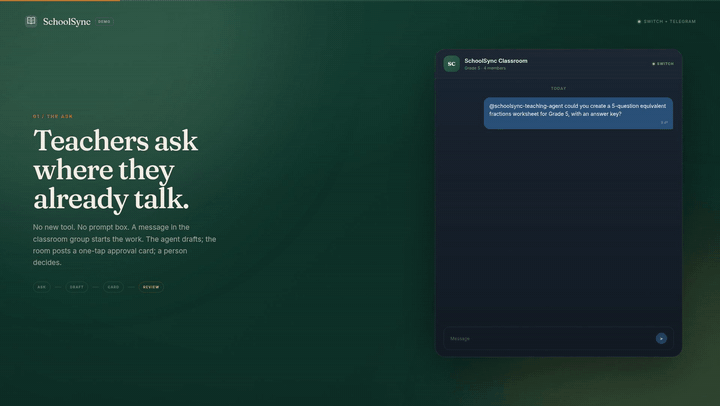

## 4:32 p.m. on a Tuesday

Picture the last hour of a school day.

Ms. Rivera wants a fractions worksheet for Grade 5 before tomorrow. Principal Hart owes families a notice about parent-teacher conferences. Coach Bello has a School Garden Day to plan. None of this is hard work. All three requests are real, small, and sitting in three different threads, waiting for someone with a key to unlock them.

Every school has this shape: tiny tasks, but coordination is expensive. And every school has this line that cannot be crossed: the thing that reaches a ten-year-old's desk, or a family's phone, must be the version a responsible adult said yes to.

That line is the whole product. We named it in the code review and then put it on the classroom projector itself:

> Nothing appears here until a human approves it.

## Why the agent does not just publish

The obvious "AI workplace" demo ends with the agent its new boss: it asks, it drafts, it ships, and the human finds out after. In a school that order is backwards, because the drafts are aimed at children and families. One wrong worksheet is a class hour. One wrong notice is a hundred parents rescheduling their week. Insurance is not a feature you bolt on later; it is the feature.

So SchoolSync inverts it. Agents do the work nobody has time for: turning "can you make a 5-question equivalent fractions worksheet for Grade 5, with the answer key" into a finished draft with a learning goal, practice questions, and an answer key. Humans keep the only two verbs that matter: approve, or send it back and say what to change.

| Who asks | In | Which agent | Who signs off | Who sees the result |
| --- | --- | --- | --- | --- |
| Teacher | Classroom chat | Teaching agent | Teacher or admin | Grade 5 students |
| Principal | Operations chat | Operations agent | Principal | Families |
| Coordinator | Activities chat | Activities agent | Coordinator | Students, staff announcement |

One chat they already use. One approval card. One publish surface. No new app for staff to ignore.

## The loop, one workflow at a time

### 1. Ask in the room they already talk in

The entry point is our favorite design decision because it is the one that keeps the product alive: staff ask in the Telegram group chat they already have for their subject room.

A note on honesty, because the rest of this post runs on screenshots: the Telegram panels in the demo video are a legibility reconstruction (a rendered chat over our real conversation), since exports of personal chats should not be public. Every app screenshot is the real product, unedited.

### 2. The draft asks for a review, not a decision

Switch routes the addressed request into the `classroom` room, the teaching agent drafts, and the draft lands in SchoolSync with one very deliberate status: **Awaiting approval**.

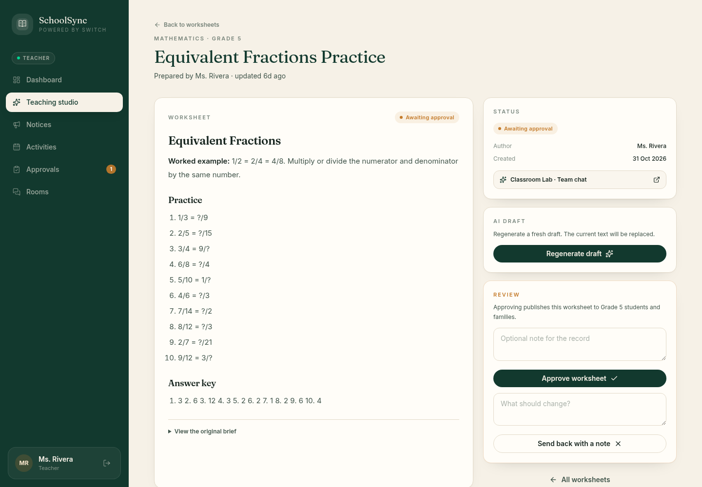

Look at what the screen gives the teacher before she has to decide anything:

- The full draft: worked example, ten practice problems, the answer key.
- **View the original brief** collapses open, so the reviewer can compare what was asked against what was produced.
- **Regenerate draft** for the i-should-have-phrased-it-better moments.
- The status panel links to `Classroom Lab · Team chat`, the exact room where the request was made. The paper trail travels with the draft.
- The button is labeled like the stakes: **Approving publishes this worksheet to Grade 5 students and families.**

### 3. The gate, in one queue

There is also a dedicated approvals page, because a decision you cannot find is a decision that does not happen.

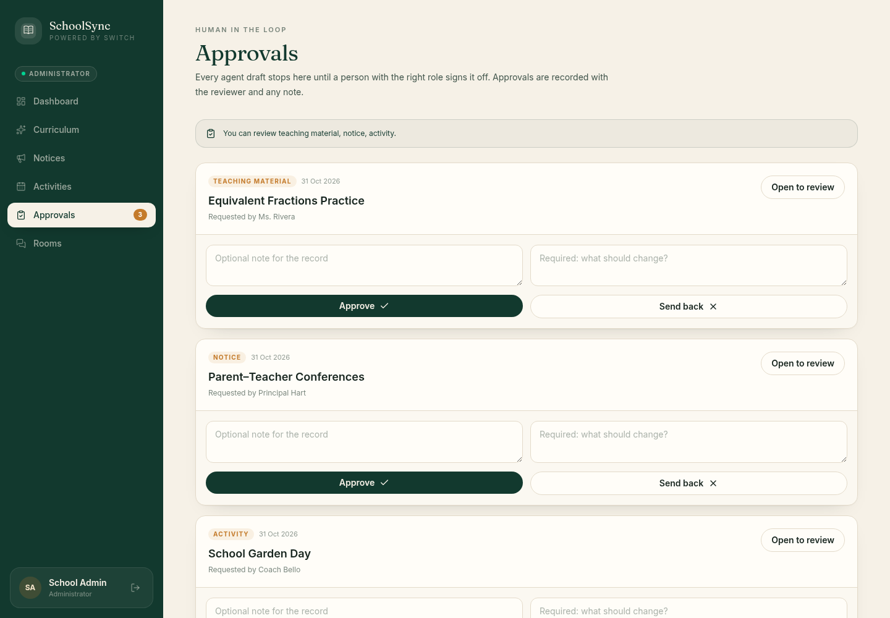

The page header is the design doc, distilled: *"Every agent draft stops here until a person with the right role signs it off. Approvals are recorded with the reviewer and any note."*

Approving is one tap. Sending back requires the reviewer to write what should change. There is no anonymous path and no ambiguity; the decision is stored as who, when, and why.

For the gamer-brained in the audience: the agent drafts in eight seconds, the human takes forty, and that is the product working. In every boss fight, the agent is just the trash mobs. You keep the drop.

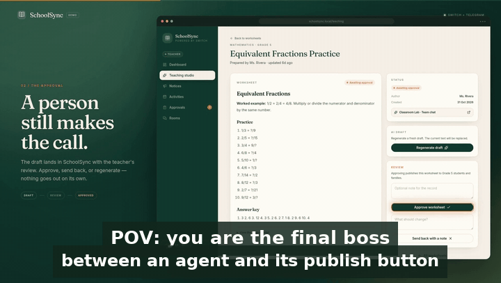

### 4. Proof, where the kids are

Approval is not an email that everything got done. It is beep-and-blink visible on the surfaces people actually look at.

After the teacher approves, the approved worksheet appears on the classroom's read-only projector view. That screen exists only for approved content:

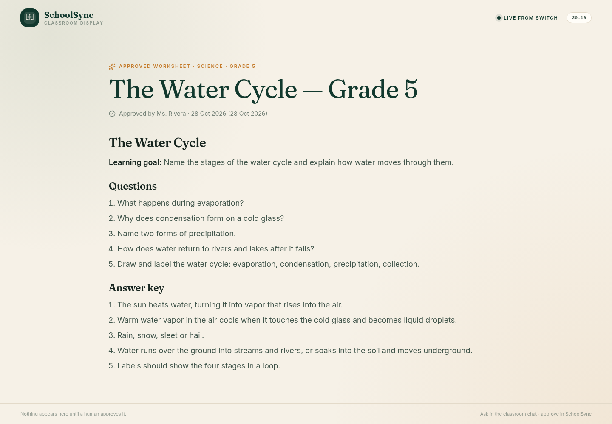

Two careful details in that footer: *"Nothing appears here until a human approves it"* on the left, and *"Ask in the classroom chat · approve in SchoolSync"* on the right. The projector tells the students where the work comes from and where the permission came from.

And in the student's own view, the draft is gone and the decision is on record: status **Approved**, author **Ms. Rivera**, approved a day after it was created, with the note *Available to students and families*.

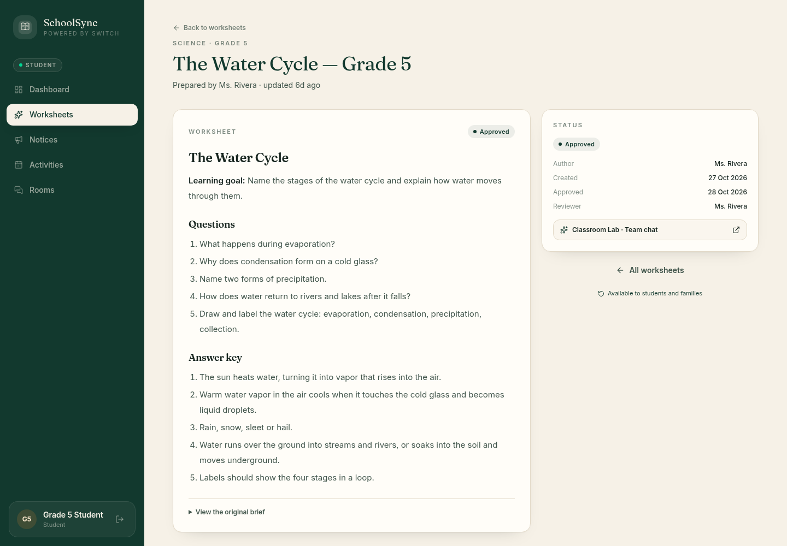

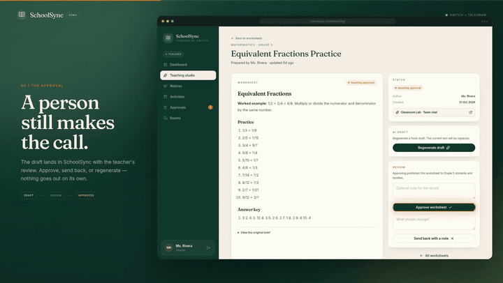

### 5. The same gate, pointed at families

The operations loop is identical, but the audience is the scarier one: parents. Principal Hart asks the operations agent for a Science Fair notice, reviews, approves, and the notice is distributed to the whole school.

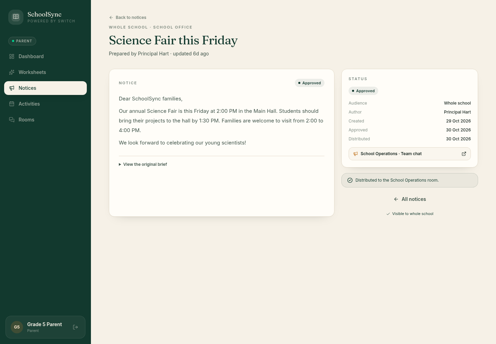

Statuses tell the reviewer's story in order: **Approved**, then **Distributed**. Two people judged this fit for families: the principal produced it, someone with the right role signed it, and the distribution step happened only after the signature.

The activities loop runs the same way. Coach Bello's School Garden Day went through the queue next to the conference notice and the fractions worksheet; approvals for one draft never gate another.

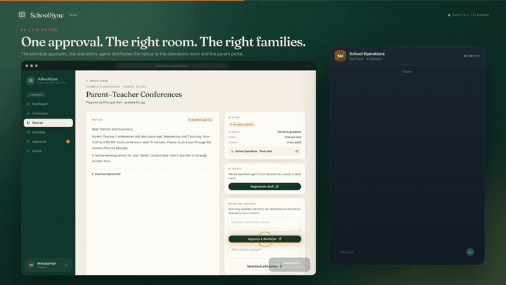

### 6. Where adults check the edges

Routine work happens in chat. The web app is the governance layer that proves the loop did what the school thinks it did.

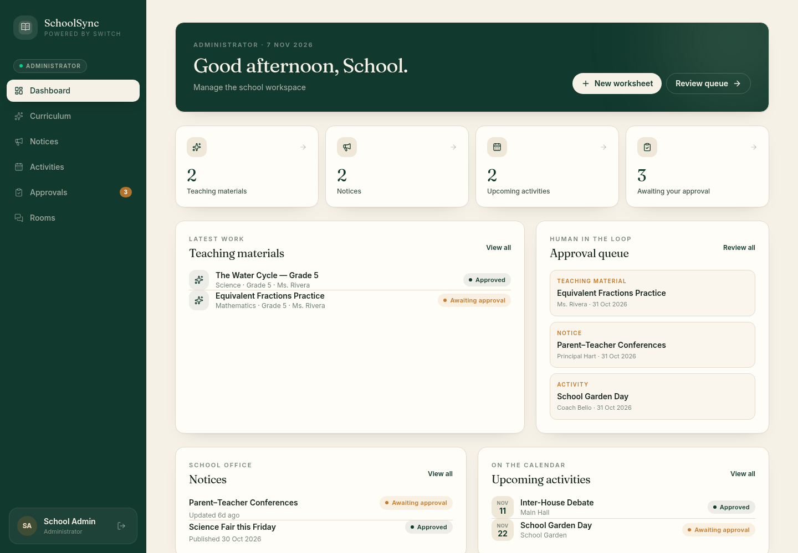

The admin console opens with a sentence we wrote for ourselves: **Keep the loop honest.**

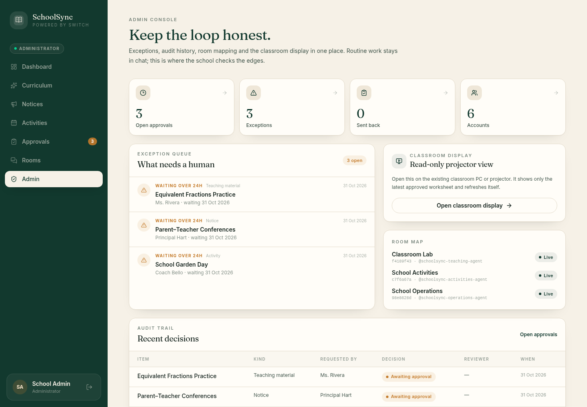

What a school administrator can check in one screen:

- **Exception queue**: drafts nobody touched yet. In this seeded demo, three items sit *waiting over 24 hours*, and the console calls them what they are.
- **Audit trail**: every recent decision with the item, the kind, who requested it, the decision, the reviewer, and when. (Amusingly, in this demo nobody has ever used the send-back button. It exists for the day someone disagrees, and disagreement should be cheap.)
- **Room map**: the three rooms and their agents, live, right there: `Classroom Lab · f4189f43 · @schoolsync-teaching-agent`, `School Activities · cff6a67a · @schoolsync-activities-agent`, `School Operations · 9e88628d · @schoolsync-operations-agent`.
- **Classroom display card**: a read-only projector view to open on the existing classroom PC. It shows only the latest approved worksheet and refreshes itself.

## How the gate actually holds

The gate is real because Switch, the orchestration platform this hackathon celebrates, holds it together:

- **Rooms are the shared workspace.** Each school function is a Switch room: `classroom`, `operations`, `activities`. The staff chat, the agent, and the app all meet in the same Postgres-backed message bus, so a reviewer reads the conversation beside the approval.
- **Agents are identities, not API keys.** Each role runs as a Switch agent with its own identity and owner scope. Only the linked owner can direct its work, which is why a random member cannot borrow the teaching agent.
- **Addressing decides the reply.** A request posted to a room is addressed; only the addressed agent replies, in the same room, where the request sits beside the draft.

The SchoolSync web app itself never calls a model. Here is the full agentic path:

1. The app posts an addressed request into the room.
2. An agent host process (a small TypeScript process per role) picks it up through the Switch agent protocol.
3. The host drafts through a provider CLI and replies into the room. Our fallback chain is `auto`: OpenCode first, then Gemini, then Ollama, so the loop degrades to a local model instead of dying with a paid API. In the demo, the three agents ran on OpenCode with an OpenRouter key, and Ollama was the local fallback.
4. The app stores the source record with the requester and the approval metadata.
5. Only the approval action publishes. There is no second path to the display.

Stack, for the "what did you build it with" folks: **Next.js 16 (App Router), React 19, Tailwind v4, Prisma over PostgreSQL**. Auth is a signed session cookie, roles are enforced in server actions and pages, and the app's own state (draft, reviewer, decision, timestamps) lives alongside the room transcript it grew out of.

Remove Switch and nothing above survives: no shared room for the app and agents to meet, no owner-scoped identity to address, no transcript beside the approval. The gate stops being a signed decision and becomes a form that says so.

## Four things nobody tells you about building this

**Your best bug report is the owner scope.** The first time we ran the demo, a teacher asked the teaching agent for the worksheet and the agent refused. That is the owner scoping working exactly as designed: the request came from an account that had not been linked to the owner's Switch user. We had spent a day building a safety we then benefited from. Link your Telegram account to the owner, or expect the agent to decline.

**Telegram privacy mode is a plot twist.** For a bot to follow ordinary conversation in a group (not just mentions), privacy mode must be off or the bot must be a group administrator. Mentions work either way, so asking *@schoolsync-teaching-agent* directly is the reliable path.

**Plan the model fallback before you need it.** Claude Code and Codex are supported provider paths, but they need working account quota. Contest infrastructure means at-11p.m.-keys. Our `auto` chain (OpenCode, then Gemini, then Ollama) means the demo keeps working and, if it falls to Ollama, still says so.

**The last 36 seconds take longer than you think.** The demo is an HTML animation (real screenshots in browser frames, a src-set story for the projector shot) recorded with Playwright and rendered with system ffmpeg: a 96-second source at 1.6×, with ElevenLabs narration on top, comes out as the submitted 60-second cut. And two embed lessons for the README: GitHub strips `iframe` tags, so the demo there is now a clickable thumbnail instead, and an 8.5 MB mp4 is friendlier as a linked artifact than an inline video.

## What we would build next

- **A 24-hour nudge in the room.** The exception queue knows a draft has waited over a day; the room should know too, politely, in chat, where the requester lives.
- **Send-back as a round trip, not a dead end.** The required "what should change?" note should already be phrased to travel back to the same agent as a revision brief.
- **Distribution windows.** A notice approved at 9 p.m. for families at 8 a.m. is a feature this school would use in week one.

## Try it

Everything is open source: **[github.com/MohdFaisalBidda/schoolsync](https://github.com/MohdFaisalBidda/schoolsync)**.

- The **60-second demo** (narrated): [watch on Google Drive](https://drive.google.com/file/d/1642yk_dKxQ5Qs5_ZFIlDnEay8ZYhkwc/view). The local cut lives in `demo/schoolsync-demo.mp4`, with the shot list, the 60-second voiceover, and the two-minute live pitch in `demo/SCRIPT.md`.
- The repo's README has the full **run-locally** walkthrough: the Switch stack with its gateway and collaboration bridge, the three agent hosts, the Next.js app with Prisma, migrations, and seeds.
- Six demo accounts ship with the seed data (admin, principal, teacher, coordinator, student, parent), password controlled by `DEMO_PASSWORD`, so every perspective above is a login away.

Ask in chat. Draft with an agent. Approve as a person. Publish to the classroom.

**Less admin. More teaching.**
